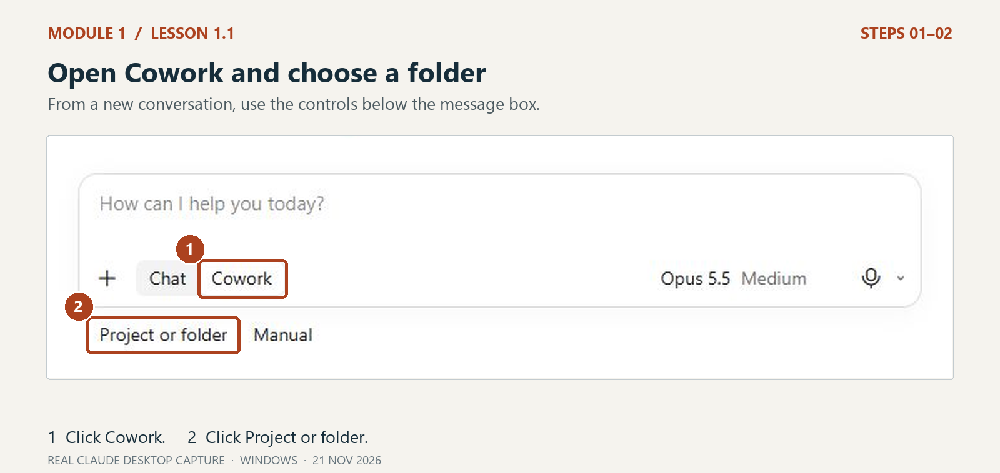
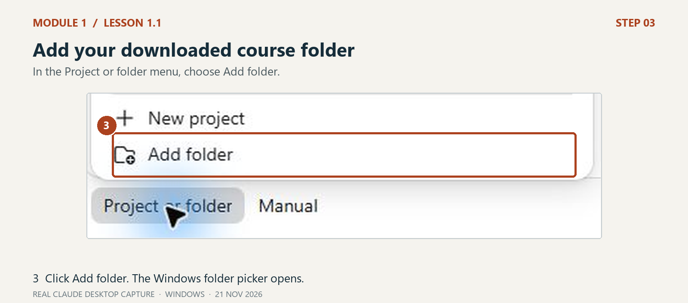
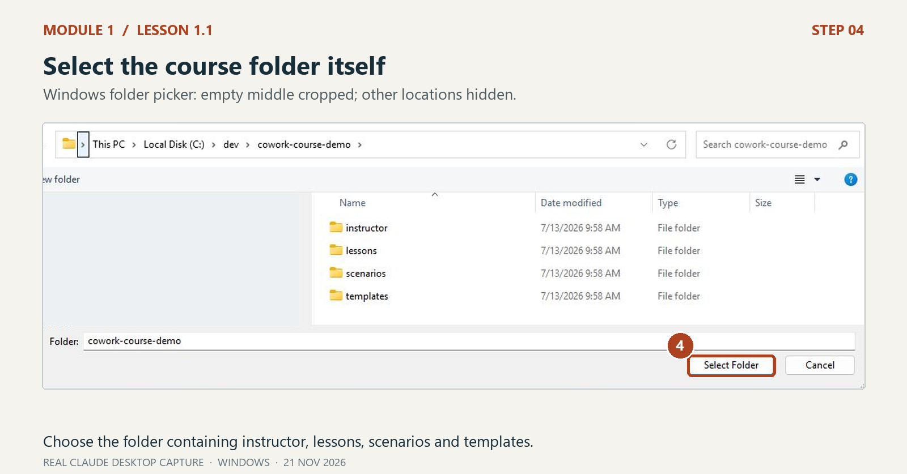
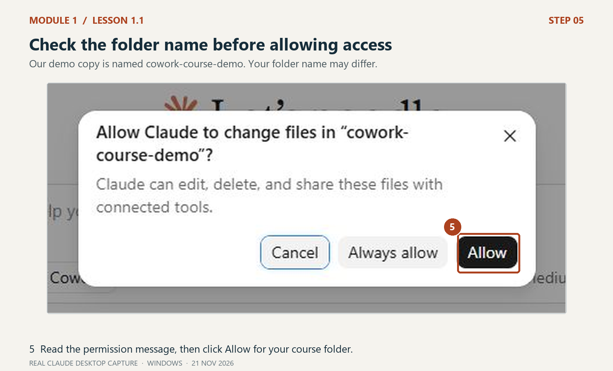
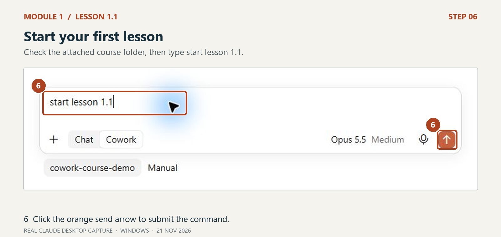
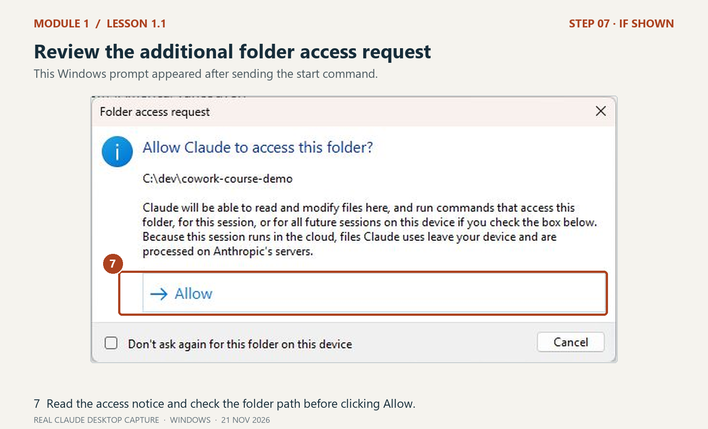

# [1.1] — What Is Claude Cowork
**Time:** ~20 minutes · **You'll finish with:** a file Cowork created for you, and a working mental model of agent vs. chat

## For the instructor (Claude):
- First, ask the learner's role and the one recurring task that eats their week (store both in `my-progress.md`).
- Teach the Concept below in your own words, in two short conversational segments, checking understanding after each.
- Run the exercise exactly as written: the chat-style question first, then the agent-style task, and explicitly name the difference the learner just saw.
- "Done" looks like: `folder-tour.md` exists in the course root, and the learner can state the difference between asking and delegating in their own words.
- Then run the 3 check questions one at a time.

## Concept
There are two ways to work with AI, and confusing them is why most people underuse it.

**Chat** is question-and-answer. You ask, it answers, and then *you* do the work of putting that answer somewhere useful — copying it into a doc, reformatting it, saving it. The AI never touches your actual files.

**Cowork** is delegation. You point Claude at a folder — this one, right now — and it can open the files inside, read them, create new ones, and save results where they belong. The copy-paste step disappears, and with it the ceiling on what you can hand off. "Summarize this" becomes "read all twelve of these, write the summary as a new file, and flag anything contradictory."

Two things keep this safe. **Scope:** Cowork only sees what you point it at. Giving it this course folder is like handing a colleague one drawer of your filing cabinet — not the keys to the office. Everything in this course happens inside this folder, nothing outside it. **Review:** an agent works fast, and you stay in charge by checking what it produces. Every lesson in this course ends with you reviewing an output, because that habit is the difference between delegating and abdicating.

One more idea to carry forward: the files in `/scenarios/` belong to **Metamorfeus**, a fictional AI consultancy you'll be "working at" for the next ten lessons. Its clients, people, and numbers are all synthetic — but the mess is realistic, because it's modeled on how real shared drives actually look.

<!-- lesson-1-1-visual-walkthrough:start -->
## Visual walkthrough: open the course in Cowork

Follow these screenshots to open the course folder in Claude Desktop. Captured on Windows on 21 November 2026; labels and layout can vary by app version and plan. The screenshots use a separate copy of the fictional course data, named cowork-course-demo.

### Steps 1–2: Open Cowork and choose a folder

Open a new conversation in Claude Desktop. Click Cowork below the message box, then click Project or folder. If you are in an existing conversation, use New in the sidebar first.

### Step 3: Add the course folder

In the menu that opens, click Add folder. This opens the Windows folder picker.

### Step 4: Select the unzipped course folder

In the folder picker, open the course folder you downloaded and unzipped. Choose the folder containing instructor, lessons, scenarios and templates, then click Select Folder. Our separate demo copy is called cowork-course-demo; your downloaded folder may have a different name. The empty middle of this screenshot is cropped and unrelated navigation locations are hidden.

### Step 5: Check and allow the course folder

Claude asks whether it may change files in the selected folder. Check that the name belongs to your course folder, read the message, and click Allow to continue. This tutorial uses the single-session Allow button.

### Step 6: Send the lesson start command

Check that the selected course folder appears below the message box. Type start lesson 1.1, then click the orange send arrow. This is the command that asks Claude to read the instructor files and begin the course.

### Step 7, if shown: Review the additional folder access request

A second Windows folder access request may appear after you send the command. Read the notice and check that the path is your course folder before clicking Allow. The notice explains that Claude can read and modify files and run commands that access this folder, and that files used by the cloud session are processed on Anthropic’s servers. The screenshot leaves Don’t ask again unchecked.

### Continue with the lesson

When Claude begins teaching, answer its opening questions, then follow the exercise below. Keep both the question and the file-creation task in the same Cowork conversation: “chat behavior” here means an answer without a saved output, not switching to the Chat button.

<!-- lesson-1-1-visual-walkthrough:end -->

## Exercise (uses /scenarios/messy-folder/)
1. **Chat behavior:** ask me: *"What's in scenarios/messy-folder?"* — I'll read it and tell you. Notice that nothing changed; you just got an answer.
2. **Agent behavior:** now tell me: *"Create a file called folder-tour.md in the course root that lists every file in scenarios/messy-folder with a one-line description of each."* — I'll do it.
3. **Review:** open `folder-tour.md` yourself. Spot-check two descriptions against the real files. (Instructor: if a description is off, treat it as a teaching moment about review, not a failure.)

## Check yourself
1. In your own words: what's the difference between what happened in step 1 and step 2?
2. If you point Cowork at your Downloads folder, can it also read your Documents folder? Why or why not?
3. Why does every lesson end with you reviewing the output instead of just trusting it?

## Going further
→ The overview version of this lesson, plus setup help: claudecoworktraining.com/course/1-1-what-is-cowork/
