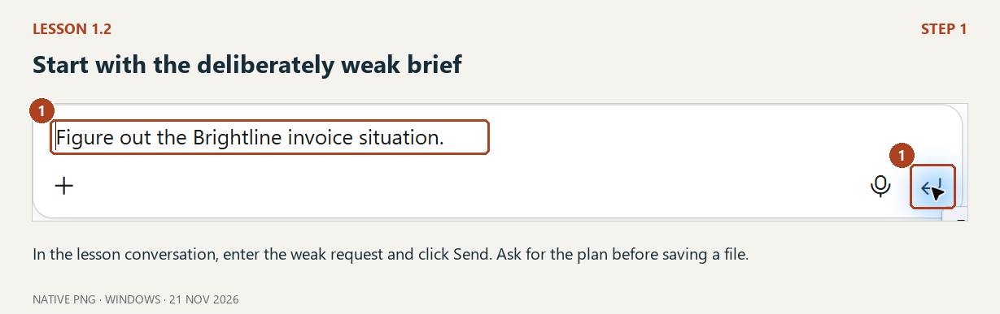
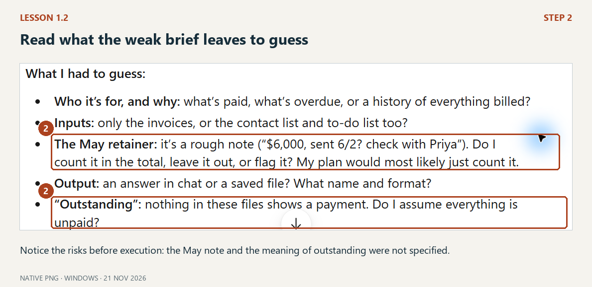
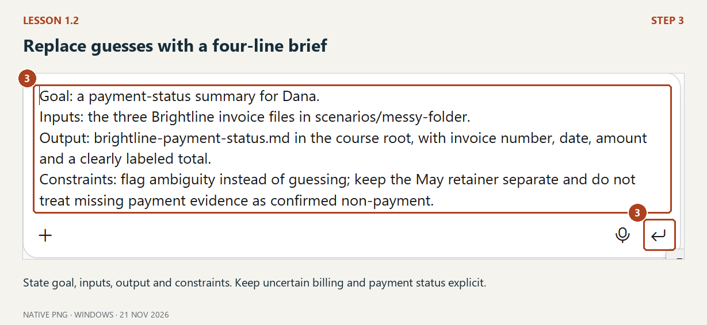
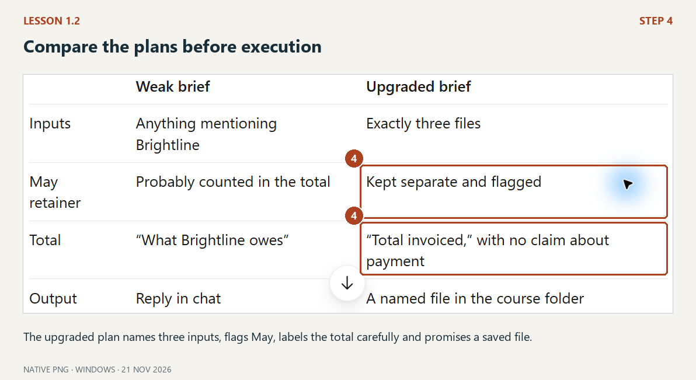
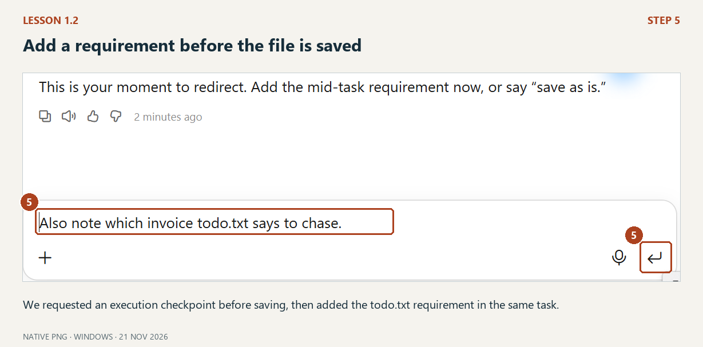
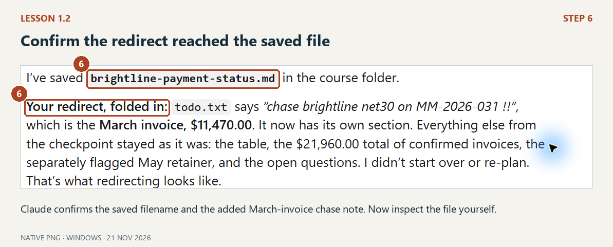
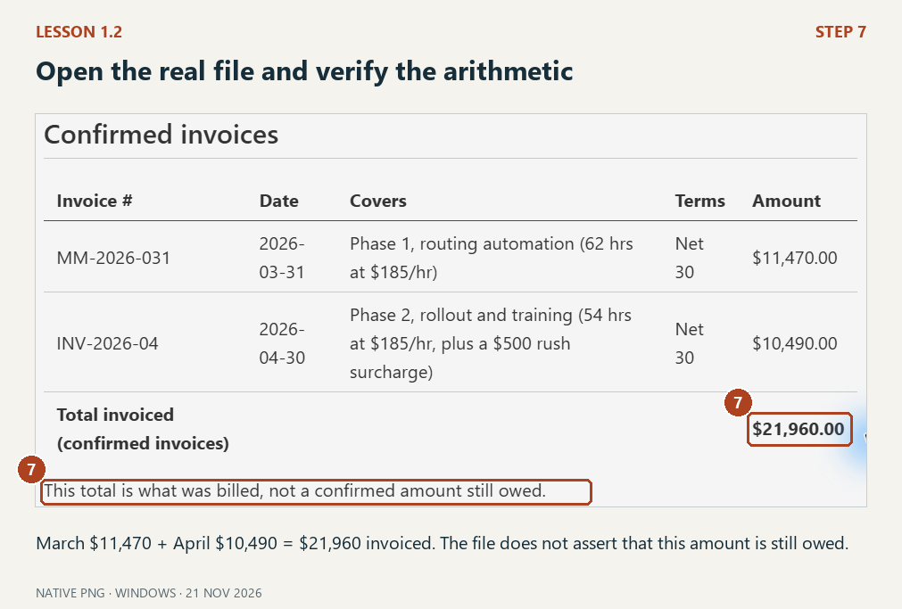
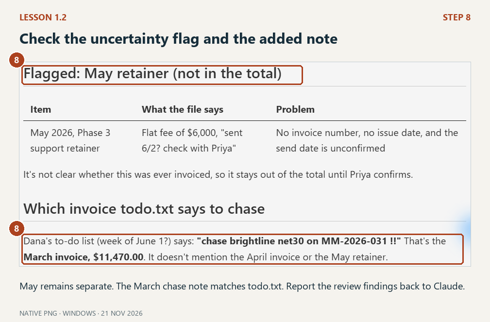
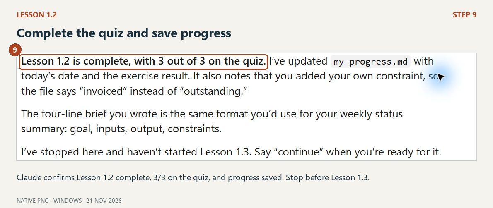

# [1.2] — Your First Task
**Time:** ~20 minutes · **You'll finish with:** a completed multi-step task and a reusable 4-line brief format

## For the instructor (Claude):
- Teach the loop (brief → plan → execute → review) with the Concept below, then immediately apply it in the exercise — don't teach all four stages abstractly before doing anything.
- In the exercise, when the learner gives the weak brief, deliberately show them your *plan* before executing and let them see where it's underspecified. Then have them upgrade the brief and compare plans.
- Practice course-correction: mid-task, have the learner change one requirement and show that redirecting beats restarting.
- "Done" looks like: `brightline-payment-status.md` exists, built from the *upgraded* brief, and the learner has redirected you once mid-task.
- Quiz, update progress, offer lesson 1.3.

## Concept
Every Cowork task runs the same loop, and once you see it, you'll never write a one-line request again.

**Brief:** what you tell Claude. The quality of everything downstream is set here. A good brief answers four questions in about four lines: what's the *goal*, what are the *inputs* (which files, which folder), what should the *output* be (a file? what name? what format?), and what are the *constraints* (length, tone, what to exclude).

**Plan:** before doing multi-step work, Claude proposes how it will proceed. This is your cheapest intervention point — correcting a plan costs seconds; correcting a finished output costs the whole task.

**Execute:** Claude does the work. You don't have to watch, but you can — and you can interrupt.

**Review:** you check the output. Not everything, but the things that matter: the numbers, the claims, anything going to a client.

The most underused move in this loop is **course-correcting mid-task**. If you see the plan or the early output drifting, say so immediately — "actually, exclude the May invoice" — rather than letting it finish and starting over. Claude keeps everything else and adjusts. People trained on chat tend to abandon and re-prompt; people trained on delegation redirect.

## Exercise (uses /scenarios/messy-folder/)
Metamorfeus scenario: Dana's todo list says to chase Brightline's unpaid invoice — but which ones, and for how much?

1. **Weak brief first.** Tell me: *"Figure out the Brightline invoice situation."* — I'll show you my plan. Notice what I had to guess: output format? Include the May retainer? A file or just an answer?
2. **Upgrade it.** Now give the 4-line version. For example: *Goal: a payment-status summary for Dana. Inputs: the three Brightline invoice files in scenarios/messy-folder. Output: brightline-payment-status.md in the course root — a table of invoice #, date, amount, plus total outstanding. Constraints: flag anything ambiguous instead of guessing.* Compare my new plan to the first one.
3. **Redirect mid-task.** While I'm working, add: *"Also note which invoice todo.txt says to chase."* Watch it get folded in without a restart.
4. **Review:** check the total against the three files yourself. (Instructor: the May invoice is deliberately vague — "$6,000, sent 6/2?" — the correct output *flags* this rather than asserting it. Make sure that lands.)

<!-- lesson-1-2-visual-walkthrough:start -->
## Visual walkthrough: brief, plan, execute, review

Follow this real Lesson 1.2 run in the same Cowork conversation and synthetic course folder used in Lesson 1.1. The screenshots are native Windows PNGs with no screenshot upscaling. App labels and layout can vary by version and plan.

If you are returning, send **start lesson 1.2** or **continue** with the course folder open. See [Lesson 1.1](1-1-what-is-cowork.md) for folder setup.

### Step 1: Send the weak brief

Start Lesson 1.2 with the course folder open. In the same Cowork conversation, send the request below. For this exercise, Claude shows a plan first and does not save a file. The Send control is at the lower right of the composer.

```text
Figure out the Brightline invoice situation.
```



### Step 2: Inspect the assumptions before approving the plan

Read the plan and its assumptions. In this real run, the weak plan could have counted the May note and described all amounts as owed. The source files do not establish payment status. This is the point to improve the brief, before Claude creates the output.



### Step 3: Give Claude the four-line brief

Replace the vague request with a specific goal, named inputs, a named output and constraints. Type all four lines in the message box, then click Send. Here the constraints keep May separate and distinguish documented invoice amounts from proven unpaid balances.

```text
Goal: a payment-status summary for Dana.
Inputs: the three Brightline invoice files in scenarios/messy-folder.
Output: brightline-payment-status.md in the course root, with invoice number, date, amount and a clearly labeled total.
Constraints: flag ambiguity instead of guessing; keep the May retainer separate and do not treat missing payment evidence as confirmed non-payment.
```



### Step 4: Compare the revised plan

Compare the new plan with the first one. The improved plan uses exactly the three invoices, keeps May separate and writes a named Markdown file. Its total is invoiced, not a claim that every invoice remains unpaid. Approve execution only after the plan matches your brief.



### Step 5: Redirect at an in-progress checkpoint

Tell Claude to go ahead and pause after reading the invoices, before saving. This capture uses an explicit checkpoint so the redirect can be inspected. Once Claude has read the inputs, send the requirement below in the same conversation. Do not start a new conversation or repeat the entire task.

```text
Also note which invoice todo.txt says to chase.
```



### Step 6: Check the completion message

Wait for Claude to finish. It confirms brightline-payment-status.md was saved and that the new requirement was incorporated. In this run, todo.txt points to March invoice MM-2026-031 for $11,470. The remaining plan stayed in place. Treat this message as a cue to review the actual file, not as proof by itself.



### Step 7: Open the saved file and check its total

In File Explorer, open your course folder, then double-click brightline-payment-status.md. Our Markdown file opened in Visual Studio Code; we clicked Open as Preview in the editor toolbar. Your editor may differ. Check the numbers against the original files: 62 × $185 = $11,470; 54 × $185 + $500 = $10,490; their sum is $21,960. This is the documented invoice total, not a confirmed outstanding balance.



### Step 8: Verify May and the redirect against the sources

Scroll down in the actual saved file. The $6,000 May retainer has no invoice number or issue date, and the send date is unconfirmed; keep it outside the confirmed-invoice total. Compare the chase section with todo.txt: it names MM-2026-031, the March invoice. Report your findings, including errors, to Claude. All 16 original scenario files remained unchanged in this demonstration.



### Step 9: Finish the quiz and confirm progress

Answer the three Check yourself questions in your own words: the four parts of a brief, why plan review is cheap, and why the May note must stay uncertain. Ask Claude to save your result in my-progress.md. This real run finished Lesson 1.2 with 3/3 and stopped before Lesson 1.3.



<!-- lesson-1-2-visual-walkthrough:end -->

## Check yourself
1. What are the four parts of a good brief?
2. Why is the plan stage the cheapest place to fix a problem?
3. In the exercise, why was flagging the May invoice better than including it in the total as fact?

## Going further
→ Overview and more brief examples: claudecoworktraining.com/course/1-2-first-task/
