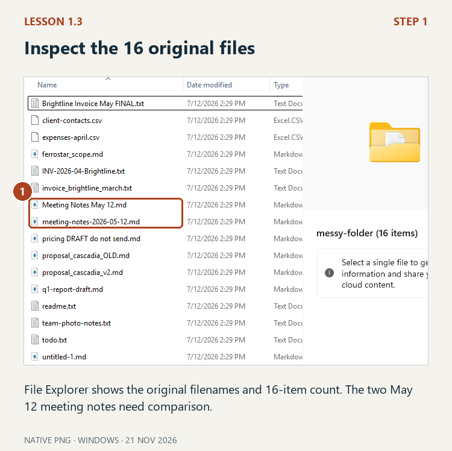
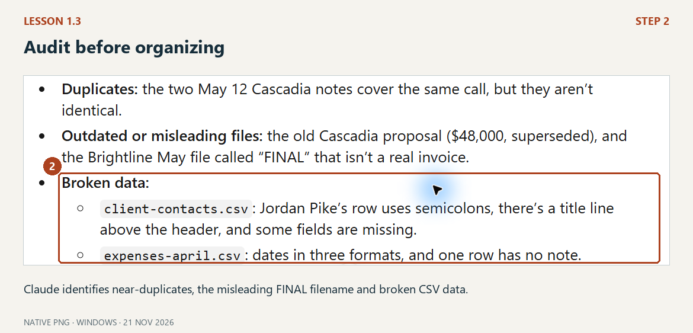
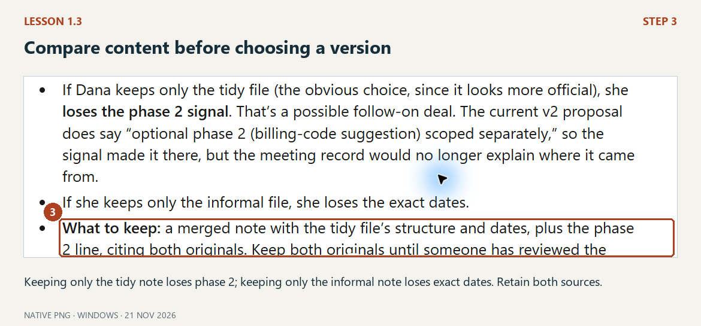
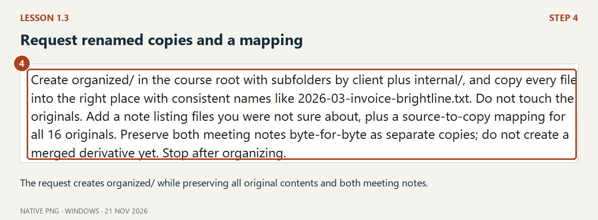
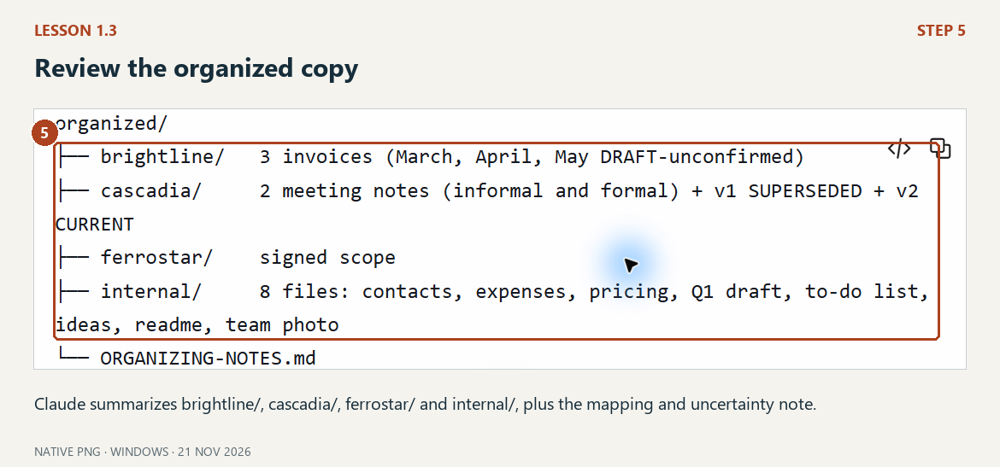
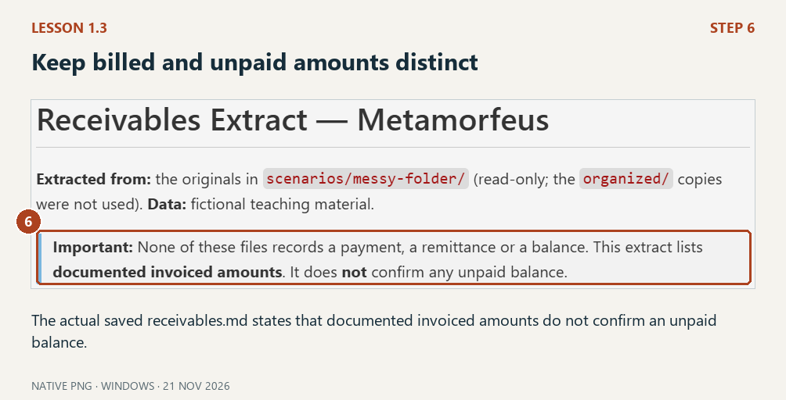
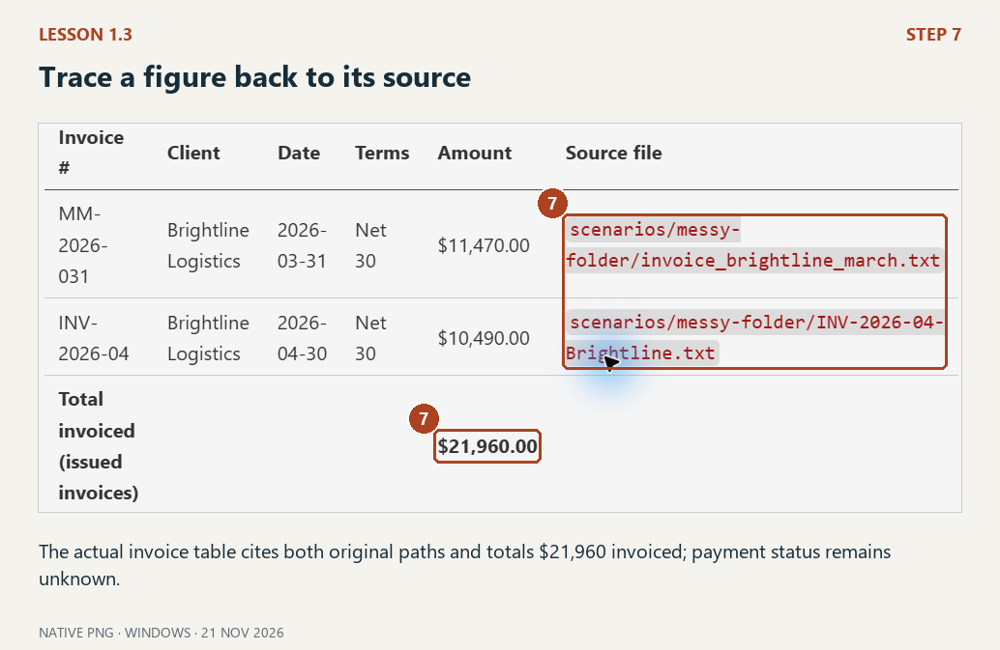
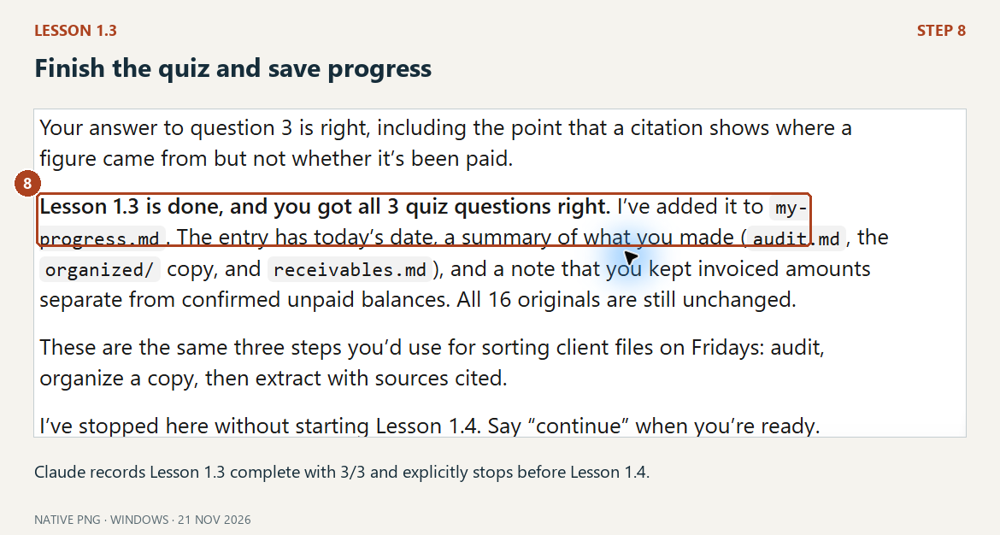

# [1.3] — Working With Files
**Time:** ~20 minutes · **You'll finish with:** the messy folder audited, organized into a clean copy, and two data problems caught

## For the instructor (Claude):
- This is the lesson the messy-folder was built for. Every flaw in it is deliberate: three inconsistently named invoices, two near-duplicate meeting notes (one contains a phase-2 detail the other lacks), a broken CSV row (semicolons in Jordan Pike's row), inconsistent expense dates, a superseded proposal, an internal-only pricing file, and two junk files.
- Sequence: audit first (read-only), then organize into a *copy* (never move originals in this lesson — teach the non-destructive habit), then the extraction task.
- Make sure the near-duplicate discovery lands: the two May 12 notes differ in one important way. Ask the learner to find what before telling them.
- "Done" looks like: `audit.md` exists, an `organized/` folder exists with a sensible structure and the originals untouched, and the learner caught the CSV problem.
- Quiz, update progress, offer 1.4.

## Concept
Real work lives in folders that look exactly like `scenarios/messy-folder`: three naming conventions for the same client's invoices, a "FINAL" file that isn't, near-duplicate notes, a CSV someone broke, and a pricing sheet that should never leave the building sitting next to the team-photo logistics.

Cowork's file skills come in three escalating levels, and this lesson runs all three.

**Audit** — read everything, change nothing. "Tell me what's here, what's duplicated, what's outdated, what looks broken." This is safe on any folder and is always the right first move on unfamiliar territory.

**Organize** — impose structure. The professional habit is *non-destructive first*: build the clean structure as a copy, review it, and only then (outside this course, on your real files) replace the original. Folders are cheap; deleted originals are not.

**Extract** — pull structured facts out of unstructured mess. "Every dollar amount owed to us, by client, with source file cited." This is where file access beats chat decisively: no copy-pasting sixteen files into a conversation.

One habit ties it together: **make Claude cite the file** for every claim it extracts. "Total invoiced: $21,960; payment status unknown (invoice_brightline_march.txt, INV-2026-04-Brightline.txt)" is checkable; a bare number is not.

## Exercise (uses /scenarios/messy-folder/)
1. **Audit:** *"Read everything in scenarios/messy-folder and write audit.md in the course root: what each file is, plus a 'problems found' section — duplicates, outdated versions, broken data, files that don't belong."* Review the problems list. Did it catch the CSV row? The two meeting notes?
2. **The duplicate question:** the two May 12 meeting-notes files aren't identical. Ask me to diff them and tell me which one Dana should keep — then decide if you agree. (Instructor: the informal one contains the phase-2 billing-codes signal; the right answer is *merge*, not pick.)
3. **Organize, non-destructively:** *"Create organized/ in the course root with subfolders by client plus internal/, and copy every file into the right place with consistent names like 2026-03-invoice-brightline.txt. Don't touch the originals. Add a note listing files you weren't sure about."*
4. **Extract:** *"From the originals, extract every outstanding amount owed to Metamorfeus into receivables.md — invoice, client, amount, source file — and flag uncertain items."*
5. **Review:** spot-check `organized/` against the originals, and verify one receivable back to its source file.

<!-- lesson-1-3-visual-walkthrough:start -->
## Visual walkthrough: audit, compare, copy, extract

Follow this real Lesson 1.3 run in the same Cowork conversation and synthetic course folder used in Lessons 1.1 and 1.2. The screenshots are native Windows PNGs with no screenshot upscaling. App labels and layout can vary by version and plan.

If you are returning, send **start lesson 1.3** or **continue** with the course folder open. See [Lesson 1.1](1-1-what-is-cowork.md) for folder setup.

### Step 1: Inspect the 16 original files

In File Explorer, open your course folder, then scenarios, then messy-folder. Inspect the 16 original files. Return to the same Cowork conversation with this course folder attached and send start lesson 1.3. Lesson 1.1 shows folder setup.



### Step 2: Audit before organizing

Send the audit request below in Claude and press Enter. Wait for audit.md, then open it from the course folder. Check the problems list against the originals: Jordan Pike uses semicolons in a comma-separated file, and expense dates use three formats. The audit writes a report without editing inputs.

```text
Read everything in scenarios/messy-folder and write audit.md in the course root: what each file is, plus a 'problems found' section ? duplicates, outdated versions, broken data, files that don't belong.
```



### Step 3: Compare content before choosing a version

Read both May 12 originals yourself before requesting a comparison. The informal note uniquely mentions possible phase 2 billing codes. The formal note provides July 15 go-live and May 20 extract review. Ask Claude to compare and recommend what Dana should retain. A reviewed merged derivative can combine these details; preserve both original notes. This run keeps separate copies and does not create that derivative.



### Step 4: Request renamed copies and a mapping

Enter the copy request in the same Claude message box and press Enter. Name the destination and the preservation constraint explicitly. Request a source-to-copy map so you can check every renamed file. Do not fix CSV contents during this organizing step.

```text
Create organized/ in the course root with subfolders by client plus internal/, and copy every file into the right place with consistent names like 2026-03-invoice-brightline.txt. Do not touch the originals. Add a note listing files you were not sure about, plus a source-to-copy mapping for all 16 originals. Preserve both meeting notes byte-for-byte as separate copies; do not create a merged derivative yet. Stop after organizing.
```



### Step 5: Review the organized copy

Wait for completion, then open organized/ in File Explorer and read ORGANIZING-NOTES.md. It maps every source to its copy and explains uncertain names or placements. Compare copies with originals; all 16 matched byte-for-byte in this run. The tree shown is Claude?s completion summary, independently checked against the saved folder. A folder called internal/ does not itself restrict access.



### Step 6: Keep billed and unpaid amounts distinct

Send the extraction request below, then open receivables.md from the course folder. Our file opened in Visual Studio Code; Ctrl+Shift+V opens Markdown Preview. Your editor may differ. Check the opening warning before using any total. None of these source files establishes a confirmed unpaid balance.

```text
From the originals, extract every outstanding amount owed to Metamorfeus into receivables.md ? invoice, client, amount, source file ? and flag uncertain items. Distinguish documented invoiced amounts from confirmed unpaid balances. Keep the May $6,000 rough note separate, and separate proposals or contract values from issued invoices. Cite original source paths. Stop for review after saving.
```



### Step 7: Trace a figure back to its source

Scroll to the issued-invoice table and open the cited original file. April is 54 ? $185 + $500 = $10,490; March is 62 ? $185 = $11,470. Their sum is $21,960 invoiced. Keep May?s $6,000 unconfirmed note outside that total. Ferrostar?s contract and Cascadia?s proposals belong in separate categories, not issued receivables. Report your source check to Claude.



### Step 8: Finish the quiz and save progress

Answer the three Check yourself questions in your own words: why audit and copy first, why compare near-duplicates by content, and why require source citations. Ask Claude to update my-progress.md. Open that file to confirm the result. This demonstration completed Lesson 1.3 with 3/3 and stopped before Lesson 1.4.



<!-- lesson-1-3-visual-walkthrough:end -->

## Check yourself
1. Why audit before organizing, and organize into a copy before ever moving originals?
2. What was the danger in the two May 12 meeting notes — and why was "keep the newer one" the wrong rule?
3. Why insist on source-file citations in the extraction step?

## Going further
→ Overview and folder-cleanup patterns for real drives: claudecoworktraining.com/course/1-3-working-with-files/
