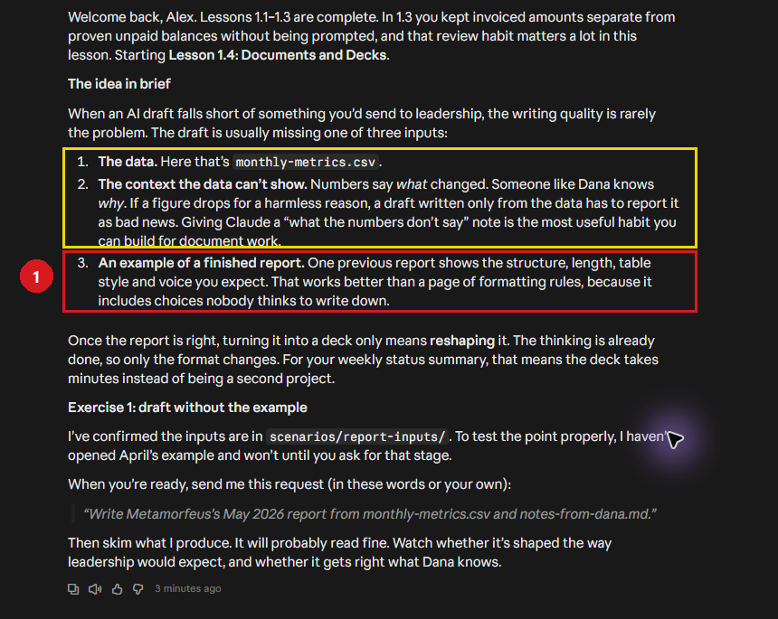
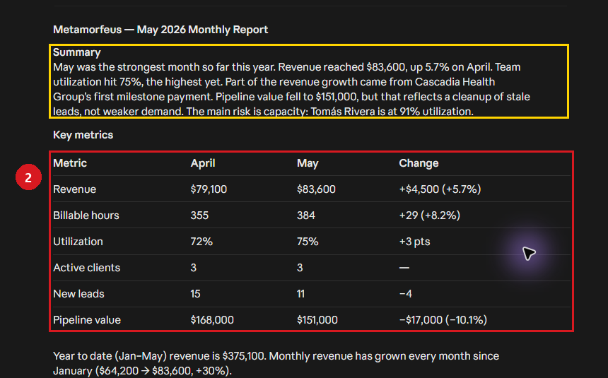
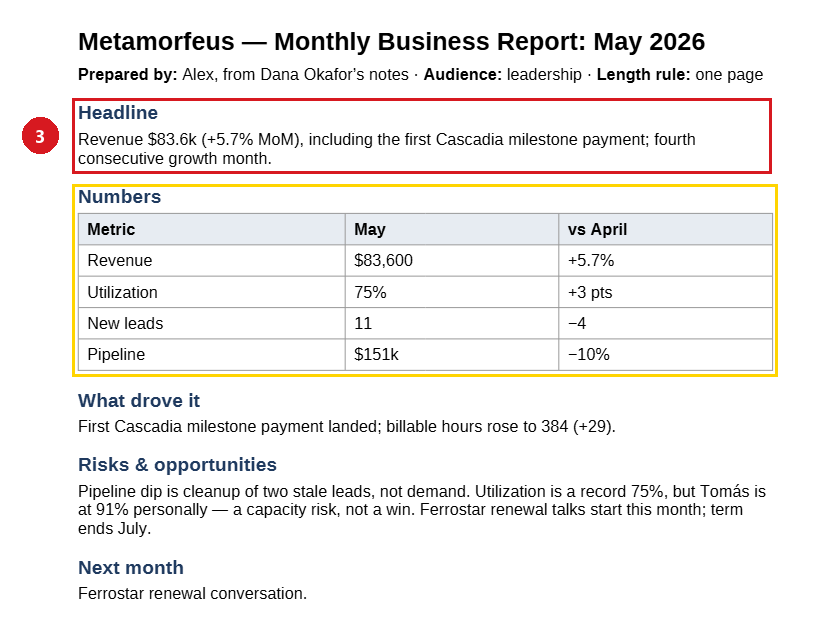
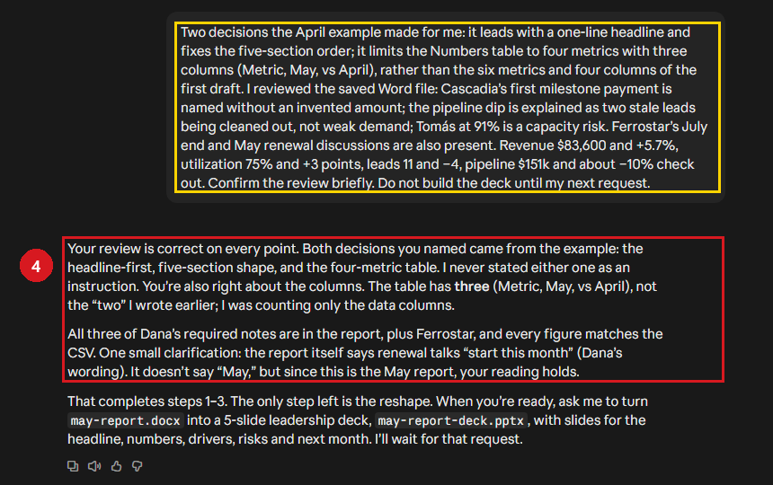
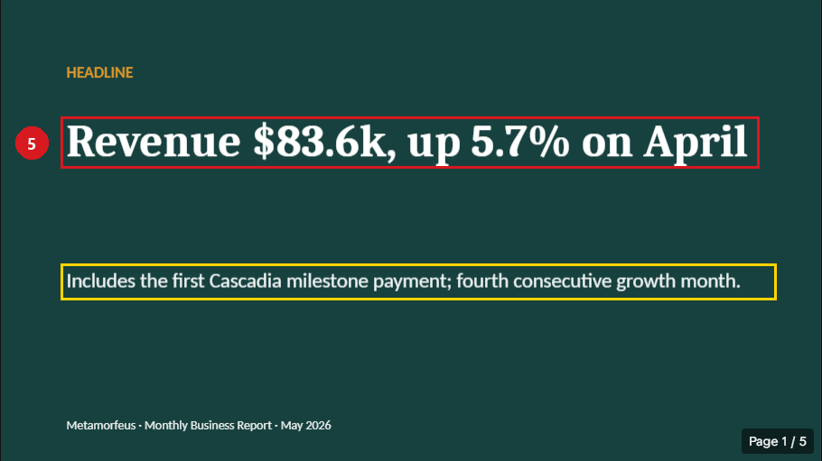
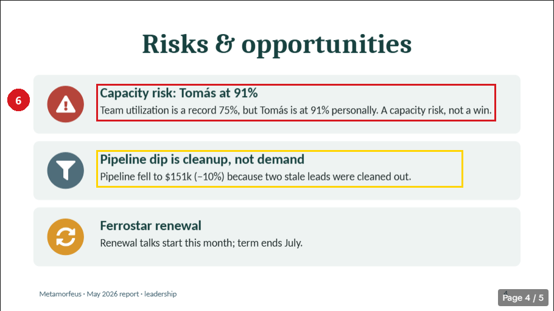
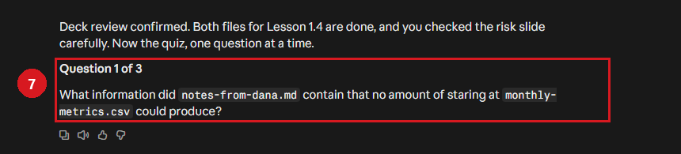
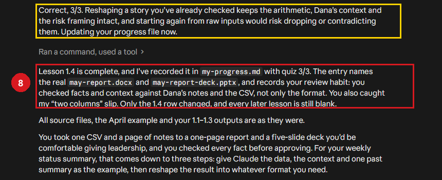

# [1.4] — Documents and Decks
**Time:** ~20 minutes · **You'll finish with:** a leadership-ready May report built from a CSV, context notes, and an example — then a deck version of it

## For the instructor (Claude):
- The core teaching: an example file is worth more than a page of format instructions. The exercise proves it by generating the report *without* the example first, then *with* it.
- Enforce Dana's notes: the pipeline dip must be explained (cleanup, not demand), Tomás's 91% must appear as a risk, the Cascadia milestone payment must be called out. If your own draft misses one, let the learner catch it in review — that's the lesson working.
- Produce the report as a Word document (.docx) and the deck as a real .pptx so the learner sees actual output files, not markdown pretending.
- "Done" looks like: `may-report.docx` and `may-report-deck.pptx` in the course root, matching the April example's structure, with all three of Dana's notes reflected.
- Quiz, update progress, offer 1.5.

## Concept
The gap between "AI-generated draft" and "document you'd actually send" is almost never writing quality. It's three inputs most people don't provide.

**The data** — obviously. Here, `monthly-metrics.csv`.

**The context that isn't in the data** — the human knowledge that turns numbers into a story. May's pipeline number *fell*, and the data can't tell you that's because two stale leads were cleaned out, not because demand dropped. Without `notes-from-dana.md`, any honest draft would report the dip as bad news. Feeding Claude the "here's what the numbers don't say" file is the single highest-leverage habit in document work.

**An example of done** — `last-month-report-example.md` shows April's report: its structure, its length discipline, its table format, its voice. One good example replaces paragraphs of format instructions and outperforms them, because it encodes decisions nobody thinks to spell out (like leading with a one-line headline).

Same inputs, different container: once the report exists, "turn this into a five-slide deck for the same audience" is a *reshaping* task, not a rewriting one. The thinking is done; only the packaging changes. That's why document-then-deck beats deck-from-scratch.

## Exercise (uses /scenarios/report-inputs/)
1. **Without the example:** *"Write Metamorfeus's May 2026 report from monthly-metrics.csv and notes-from-dana.md."* Skim my draft. It's probably fine — and probably shaped nothing like what leadership expects.
2. **With the example:** *"Redo it matching the structure, length, and voice of last-month-report-example.md exactly. Save as may-report.docx in the course root."* Compare. Name two decisions the example made for you.
3. **Review against Dana's notes:** check all three landed — milestone payment called out, pipeline dip explained correctly, Tomás's utilization framed as risk. If one is missing, don't fix it yourself: tell me what's wrong and have me revise. (Redirect, don't redo — lesson 1.2's habit.)
4. **Reshape:** *"Turn may-report.docx into a 5-slide leadership deck, may-report-deck.pptx: headline, numbers, drivers, risks, next month."* Open it. Review the risk slide especially.

<!-- lesson-1-4-visual-walkthrough:start -->
## Visual walkthrough: draft, match, review, reshape

Follow a real Lesson 1.4 run in Claude Desktop using the synthetic Alex course folder restored after Lessons 1.1–1.3. Native lossless PNGs are cropped without resampling and annotated with red primary and yellow supporting highlights. App labels and layout can vary by version and plan. Open any image at full size to inspect the text.

### 1. Resume from saved progress and identify the three inputs

Open the course folder in Cowork and start Lesson 1.4. In a new conversation, ask Claude to read the saved progress rather than repeating earlier lessons. The three inputs are the CSV, Dana’s context notes and an example of the finished report. Keep the example unopened until the second draft.

```text
Read START-HERE.md, instructor/INSTRUCTOR.md, my-progress.md and lessons/1-4-documents-and-decks.md. Start Lesson 1.4 only. Introduce the exercise, then wait. Do not open last-month-report-example.md until the with-example stage.
```



### 2. Read the draft without an example

Ask for May’s report using only the CSV and Dana’s notes. This real first draft is accurate but chooses its own summary, six-metric table and section order. Review those choices before supplying the example; do not assume a readable draft matches leadership’s format.

```text
Write Metamorfeus’s May 2026 report from monthly-metrics.csv and notes-from-dana.md in scenarios/report-inputs/. Do not open last-month-report-example.md yet. Show the draft here for review.
```



### 3. Apply the example and open the real Word file

Now ask Claude to match the April example and save may-report.docx in the course root. Open the file. This one-page report uses Headline, Numbers, What drove it, Risks & opportunities and Next month. The example chose a headline-first opening and a four-metric, three-column table without a long formatting brief.

```text
Redo it matching the structure, length and voice of scenarios/report-inputs/last-month-report-example.md. Save a real may-report.docx in the course root. Keep Dana’s context and correct May-versus-April arithmetic; do not invent the Cascadia payment amount.
```



### 4. Check the context and arithmetic before reshaping

Check all three required notes in the saved report: Cascadia’s first milestone payment, two stale leads explaining the pipeline dip, and Tomás’s 91% utilization as a capacity risk. Verify the source arithmetic too. This run caught a small chat-description error: the table has three columns, not two. The saved table itself was correct. Redirect an incorrect output instead of silently rewriting it.



### 5. Reshape the approved report into five slides

Use the finished report as the deck’s source. Ask for exactly five slides: headline, numbers, drivers, risks and next month. Open may-report-deck.pptx and review every slide. This is a real editable PowerPoint package; the native preview shown here is its first slide.

```text
Turn may-report.docx into a real 5-slide leadership deck, may-report-deck.pptx, in the course root: headline, numbers, drivers, risks, next month. Reshape the finished report, preserving the figures and Dana’s context. Keep text editable and readable.
```



### 6. Review the risk slide rather than trusting the conversion

Inspect slide 4 closely. Team utilization of 75% must not hide Tomás’s 91% capacity risk. The pipeline’s roughly 10% fall is explained by cleanup of two stale leads, and Ferrostar’s renewal timing remains visible. The saved file was checked for five editable slides, valid Office structure and matching source figures.



### 7. Answer the quiz one question at a time

After reviewing both actual files, answer the three lesson questions individually. Explain what Dana knew beyond the CSV, why an example communicates unstated format choices, and why a deck should reshape a reviewed report. Use your own words before moving to the next question.



### 8. Confirm the files and saved progress

Claude recorded Lesson 1.4 with quiz 3/3 and both real Office filenames. Reopen my-progress.md to verify the saved row. In this run every source and earlier output stayed unchanged, including the April example and the 16 messy-folder originals. The next lesson remains blank; completing a quiz does not itself start another lesson.



<!-- lesson-1-4-visual-walkthrough:end -->

## Check yourself
1. What information did notes-from-dana.md contain that no amount of staring at the CSV could produce?
2. Why does one example file usually beat detailed formatting instructions?
3. Why build the deck from the finished report instead of from the raw inputs?

## Going further
→ Overview plus document-type patterns (proposals, memos, one-pagers): claudecoworktraining.com/course/1-4-documents-and-decks/
