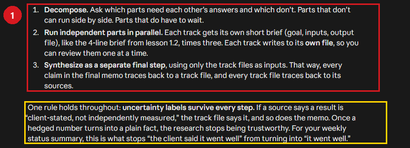
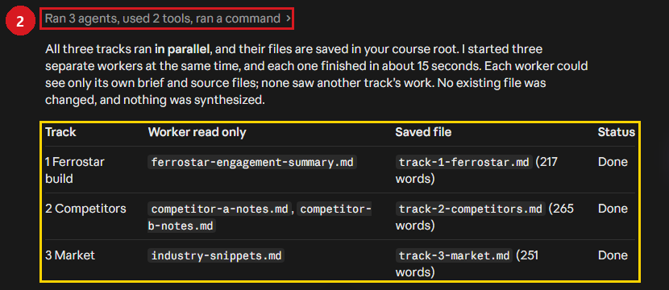
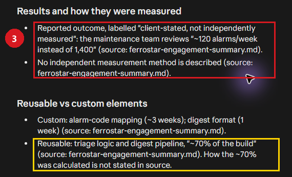
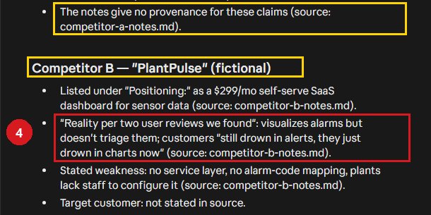
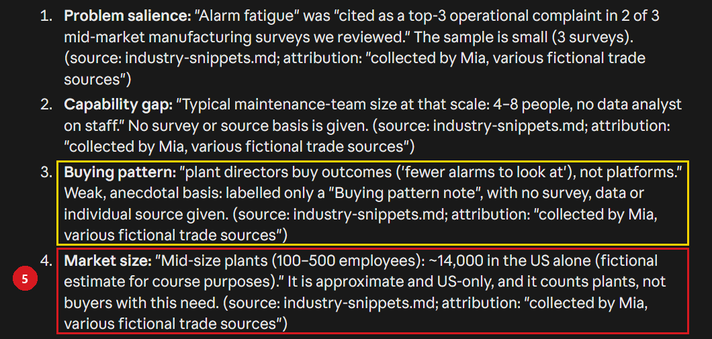
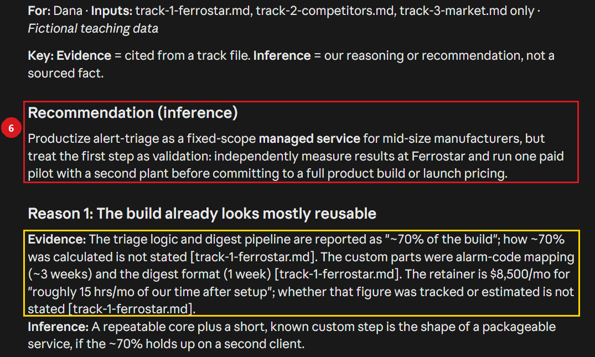
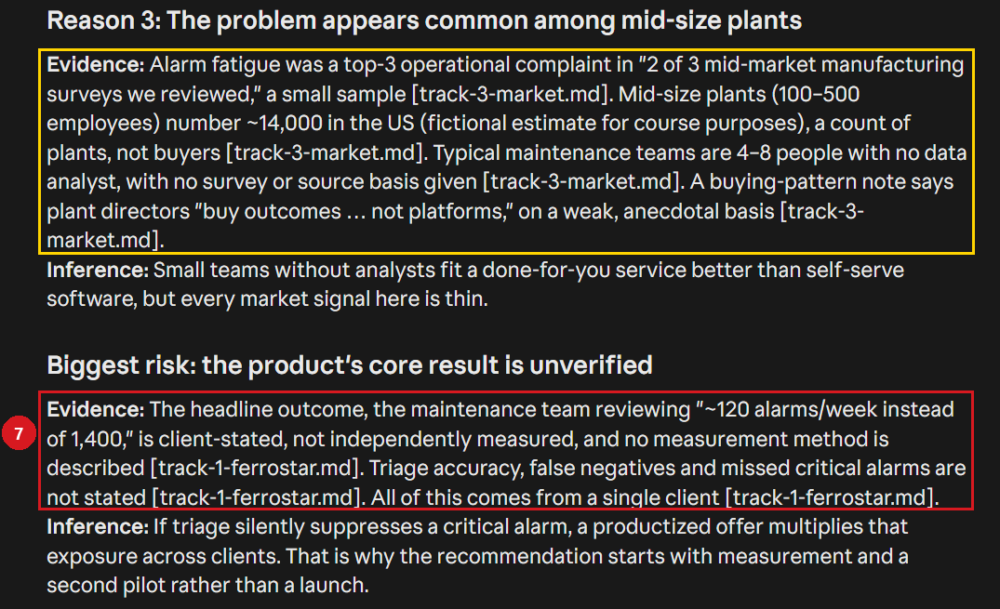
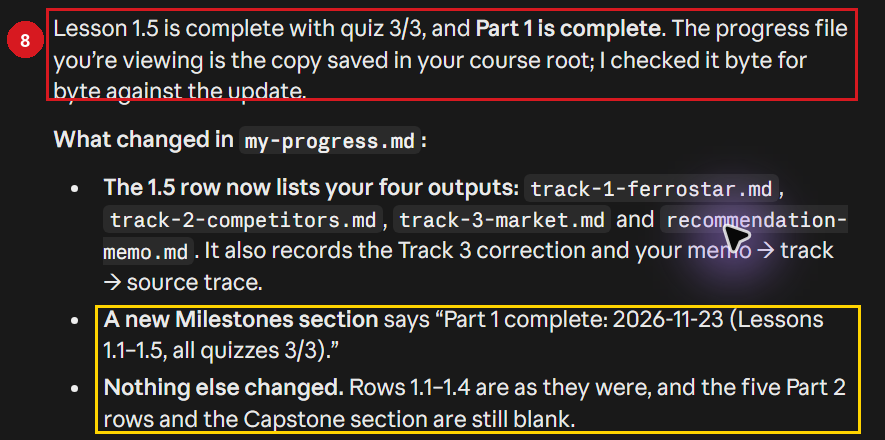

# [1.5] — Agents and Parallel Work
**Time:** ~25 minutes · **You'll finish with:** a three-track research project run in parallel and synthesized into one recommendation memo

## For the instructor (Claude):
- The teaching pivot: lessons 1.1–1.4 were one task at a time; real work is several at once. Teach decomposition (independent tracks) → parallel execution → synthesis.
- Run the three research tracks from `brief.md` as parallel workstreams where the environment supports it; if running them concurrently isn't possible in the learner's setup, run them as three cleanly separated sequential tracks and say so honestly — the *decomposition and synthesis* skill is the lesson, parallelism is the accelerator.
- Guard the evidence rules: the Ferrostar outcome is client-stated, the market-size figure is a fictional estimate — the memo must carry those labels through. If your synthesis drops a label, that's the review-step teaching moment.
- "Done" looks like: three track files in the course root (`track-1-ferrostar.md`, `track-2-competitors.md`, `track-3-market.md`) plus `recommendation-memo.md` that cites all three and keeps every uncertainty label.
- Quiz, update progress. This completes Part 1 — mark the milestone in `my-progress.md` and preview Part 2 in one sentence (from features to team systems).

## Concept
The tasks so far had one thread: read inputs, produce output. But the work that actually eats weeks — "should we launch this?", "what happened in Q2?", "which vendor?" — is really three or four *independent* questions wearing a trenchcoat. The skill is seeing the seams.

**Decompose** by asking: which parts of this need each other's answers, and which don't? In today's brief, summarizing the Ferrostar build, assessing competitors, and reading market signals share nothing — none needs another's output. Independent tracks can run in parallel; dependent ones can't. (Writing the final memo depends on all three, so it comes last, alone.)

**Parallelize** the independent tracks. Each track gets its own mini-brief — goal, inputs, output file — exactly the 4-line format from lesson 1.2, just three of them at once. Each track writes its findings to its *own file*, which matters for the next step.

**Synthesize** as a separate, final task whose inputs are the three track files. Keeping synthesis separate does two things: it forces each track's output to stand on its own (reviewable one at a time), and it makes the final memo's reasoning traceable — every claim points back to a track file, every track file points back to sources.

One discipline carries the whole thing: **uncertainty labels survive every hop**. The source file says the Ferrostar result is "client-stated, not independently measured" — so the track file says it, so the memo says it. The moment a hedged number becomes a bare fact, your research is fiction.

## Exercise (uses /scenarios/research-brief/)
1. **Read the brief:** open `brief.md` — Dana wants a productization recommendation by Friday.
2. **Decompose:** tell me which of the three research tasks depend on each other. (They don't — say why.)
3. **Launch the tracks:** *"Run the three research tasks from brief.md in parallel. Each writes its own file: track-1-ferrostar.md, track-2-competitors.md, track-3-market.md. Findings only, with source labels — no recommendations yet."*
4. **Review the tracks** one at a time — this is why they're separate files. Check track 1 kept the "client-stated" label and track 3 kept the "fictional estimate" label.
5. **Synthesize:** *"From the three track files only, write recommendation-memo.md per the brief: one recommendation, three reasons, biggest risk, one page. Every claim cites its track file."*
6. **Review the memo:** trace one claim from memo → track file → source. Did the labels survive both hops?

<!-- lesson-1-5-visual-walkthrough:start -->
## Visual walkthrough: decompose, research, review, synthesize

Follow a real Lesson 1.5 run in Claude Desktop using the synthetic Alex course folder restored after Lessons 1.1–1.4. Native lossless PNGs are cropped without resampling and annotated with red primary and yellow supporting highlights. App labels and layout can vary by version and plan. Open any image at full size to inspect the text.

### 1. Separate independent research from synthesis

Identify which tasks need another task's answer. Give independent tracks separate briefs and files, review them individually, and synthesize only afterward. Preserve uncertainty labels through every step.



### 2. Verify actual execution and separate outputs

This run's activity summary shows three agents, and the completion table lists each track's own source and saved file. Concurrent execution depends on the available environment. The approximately 15-second timing is Claude-reported, not independently measured.



### 3. Review the engagement evidence and its limits

Open the actual saved Ferrostar track. The roughly 120 versus 1,400 weekly alarms result remains client-stated, not independently measured. The roughly 70% reusable figure also keeps its approximation and missing-method caveat.



### 4. Review the competitors' evidence limits

Open the saved competitor findings. Both competitors are fictional. SentinelOps' notes give no underlying provenance, and PlantPulse's no-triage claim rests on only two user reviews. Carry those limits into any recommendation instead of presenting the claims as independently verified market facts.

```text
Present the existing track-2-competitors.md in the native viewer without changing it. Check the fictional labels, missing provenance for Competitor A, and the two-user-review basis for PlantPulse's claim. Do not synthesize yet.
```



### 5. Correct interpretations before synthesis

Compare Track 3 with its source. In this run, review removed an unsupported statement about the remaining survey and an interpretation about platform packaging. The revised file retains the weak, anecdotal buying note and labels the roughly 14,000 US plants figure a fictional estimate for course purposes. A count of plants is not a count of buyers.

```text
Review track-3-market.md against industry-snippets.md. Remove unsupported interpretations from findings, preserve the source citations and fictional estimate label, then show the actual saved revised file. Do not synthesize yet.
```



### 6. Synthesize only after reviewing all three tracks

The actual saved 484-word memo uses the three reviewed track files as its only inputs. It gives one recommendation, three reasons and the biggest risk. Evidence cites a track file; the recommendation and reasoning are explicitly marked as inference. The proposed managed service starts with validation and a second pilot, rather than assuming the fictional evidence proves a market.

```text
From the three reviewed track files only, write recommendation-memo.md: one recommendation, three reasons, biggest risk, one page. Every factual claim cites its track file. Keep all uncertainty labels and distinguish evidence from inference.
```



### 7. Trace claims from memo to track to source

Review the saved memo, then open the cited track and its original source. The alarm counts trace through track-1-ferrostar.md to ferrostar-engagement-summary.md and remain client-stated, not independently measured. The US plant count traces through track-3-market.md to industry-snippets.md and remains a fictional estimate for course purposes. Both qualifications survived both hops; the memo does not replace them with a measured percentage or a proven market size.



### 8. Complete the quiz and save the Part 1 milestone

Answer the three questions individually: which tasks are independent, why separate track files matter, and what goes wrong when synthesis drops an uncertainty label. In this demonstration, Alex scored 3/3. The saved progress file lists all four outputs and marks Part 1 complete. Earlier lesson rows are preserved and Part 2 remains blank; stop here before starting a new lesson.



<!-- lesson-1-5-visual-walkthrough:end -->

## Check yourself
1. What test tells you whether two tasks can run in parallel?
2. Why write each track to its own file instead of one combined file?
3. A track file says "client-stated, not independently measured" but the memo says "reduced alarm review by 91%." What went wrong, and why does it matter?

## Going further
→ Overview and more decomposition patterns: claudecoworktraining.com/course/1-5-agents-and-parallel-work/
