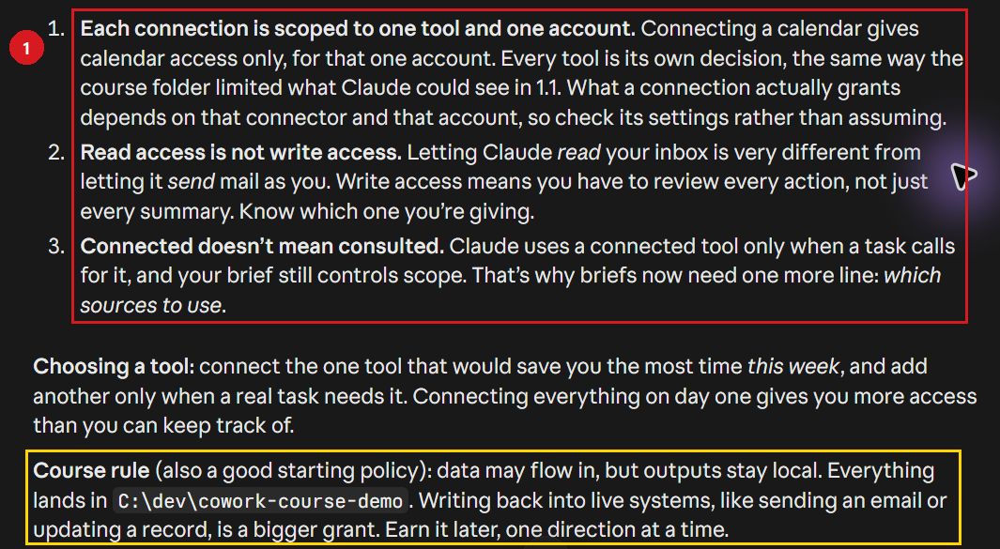
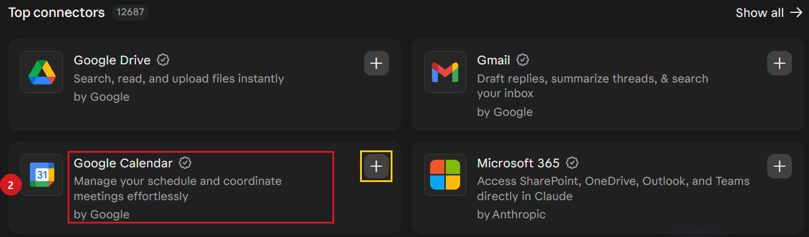
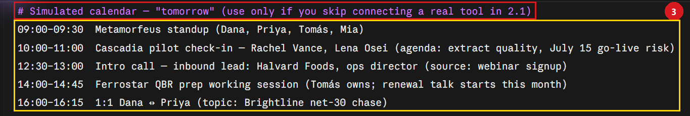
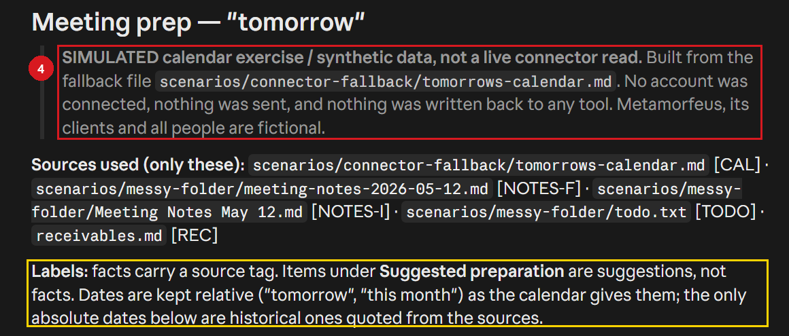
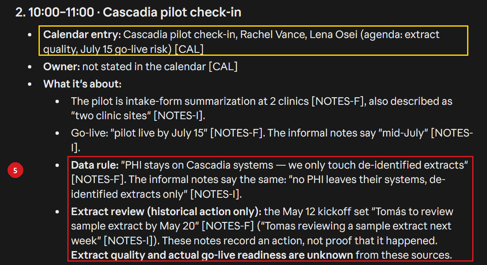
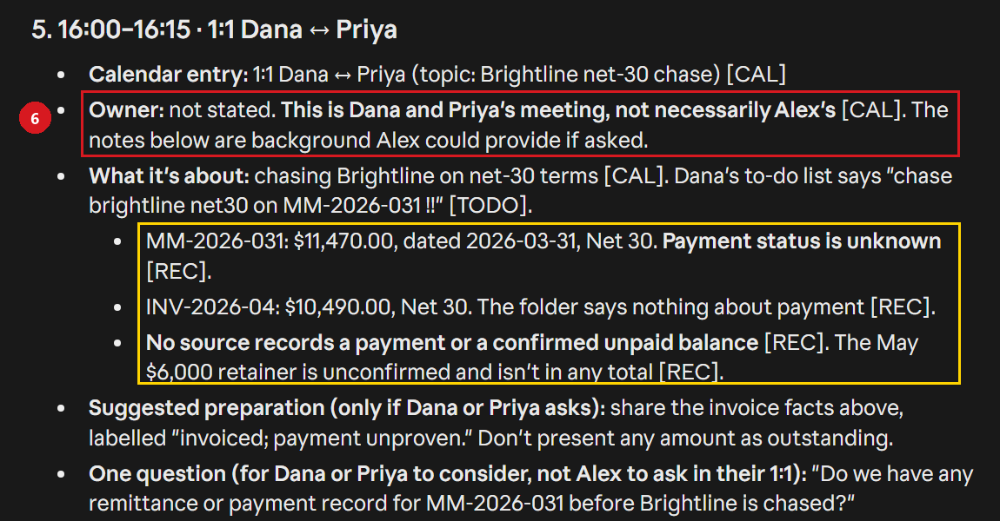
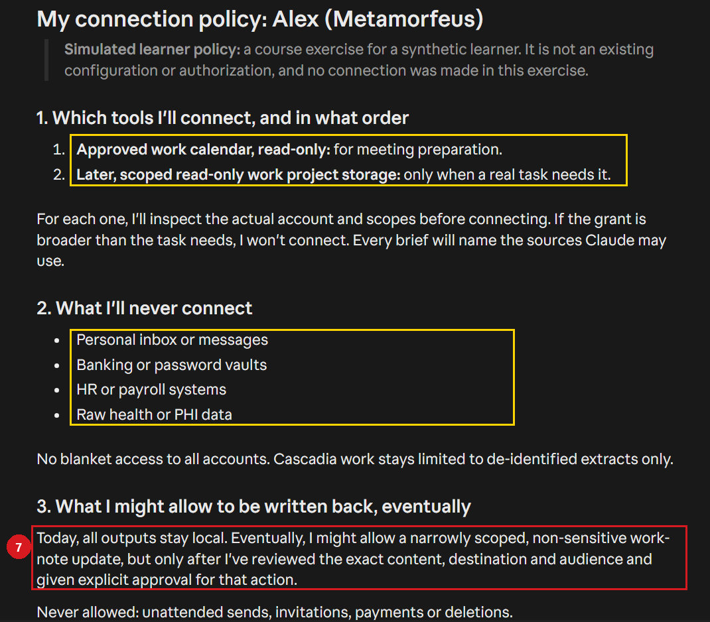
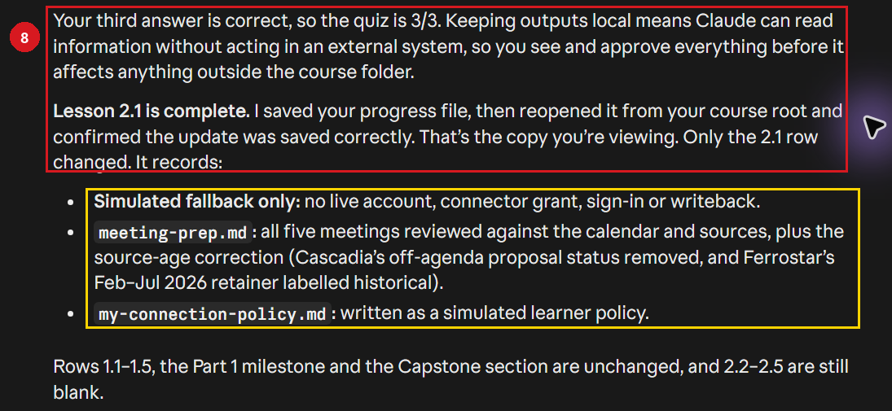

# [2.1] — Connectors
**Time:** ~20 minutes · **You'll finish with:** one connected tool (or the fallback drill), a cross-boundary task completed, and a written connection policy for yourself

## For the instructor (Claude):
- Teach the permission model FIRST, before anything gets connected — deliberate beats maximal.
- Then guide connecting one real tool (calendar or file storage is the easiest win). You cannot connect it for them; walk them through their client's connector settings and verify by reading something trivial from the connected tool.
- If the learner can't or won't connect a real tool, run the full exercise on /scenarios/connector-fallback/ instead and say plainly that it's simulated — the decision skills transfer, the setup steps they'll do later.
- Cross-boundary rule for this course: connected data may come IN, but every output still lands in this course folder. Never write into their connected tools during the course.
- "Done" looks like: `meeting-prep.md` exists (from real or fallback calendar) and `my-connection-policy.md` exists with their three answers.
- Quiz, update progress, offer 2.2.

## Concept
Everything so far ran on files you handed over. Connectors remove the handing-over: Cowork can read your calendar, search your messages, pull documents from cloud storage — the systems your job actually runs on.

The skill of this lesson isn't clicking "connect." It's the **permission model**, three facts that should shape every connection decision. First, *connectors are scoped*: connecting your calendar grants calendar access, nothing else — each tool is its own decision, like the folder-scoping rule from 1.1 extended outward. Second, *access is not authorship*: reading your inbox and sending mail as you are wildly different grants; know which one you're giving. Third, *connected doesn't mean consulted*: Claude uses connected tools when a task calls for them, but your brief still controls what's in scope — which is why briefs now need a line they never needed before: *which sources to use*.

The selection rule: connect the one tool that would save you the most time **this week**, and add others only when a real task demands them. People who connect everything on day one create a review surface they can't manage; people who connect one tool per real need always know what Claude can see and why.

And a course rule that's also a good starter policy: data flows in, outputs land locally. Writing back into live systems — sending the email, updating the CRM — is a bigger grant with a bigger review burden. Earn it one direction at a time.

## Exercise
1. **Pick one:** which single tool would save you the most time this week? Say it and why.
2. **Connect it** (I'll walk you through your client's connector settings), then verify: ask me to read one trivial thing from it. *No connection today? Say "use the fallback" and we run steps 3–4 on /scenarios/connector-fallback/.*
3. **Cross the boundary:** *"Read tomorrow's calendar and write meeting-prep.md in the course root: for each meeting, what it's about, what I should have ready, and one question I should ask."* (Fallback: same brief against tomorrows-calendar.md — note how the Cascadia check-in prep should pull in what you learned about extracts in earlier lessons.)
4. **Review** the prep doc against the actual calendar. Did anything get misread?
5. **Write your policy:** create `my-connection-policy.md` answering: which tools will I connect and in what order? what will I never connect? what outputs am I comfortable having written back, eventually?

<!-- lesson-2-1-visual-walkthrough:start -->
## Visual walkthrough: permissions first, simulated calendar, local review

Follow a real Lesson 2.1 demonstration in Claude Desktop using the synthetic Alex course folder. This run uses the explicitly simulated calendar fallback: no live calendar or inbox was read, no account was connected, and no external access or writeback was granted. The connector directory is shown only for orientation; detailed authorization scopes are not demonstrated. Native lossless PNGs are privacy-cropped without resampling and use red primary/yellow supporting highlights. Open an image at full size to inspect small text.

### 1. Learn the permission model before connecting

Treat every connector and account as a separate access decision. Review the provider's actual scopes: read and write permissions carry different review burdens, and a connector may bundle several scopes. A connection being available does not put it in every task's scope; name the allowed sources in your brief. This demonstration uses simulation and keeps outputs local.



### 2. Inspect the directory without granting access

In this Claude version, Customize → Connectors → Discover shows a Google Calendar listing and an Add control. This is a directory view, not proof of an account connection or a read-only grant. We did not select Add or Connect. Detailed authorization scopes and read/write switches are not visible here and are not demonstrated; the exercise continues with the supported simulated fallback.



### 3. Review the explicitly simulated source

Use scenarios/connector-fallback/tomorrows-calendar.md when you skip a real connection. The actual file contains five entries: 09:00 standup, 10:00 Cascadia check-in, 12:30 Halvard Foods introduction, 14:00 Ferrostar QBR prep and 16:00 Dana–Priya 1:1. These are synthetic scenario times; no real date or timezone is supplied. Check the source before requesting a local preparation document.



### 4. Generate a local document from named sources

Ask for meeting-prep.md in the course folder using the simulated calendar and explicitly allowed local context. The actual output labels itself simulated and identifies its sources. Facts carry source tags; preparation items are suggestions. The scenario's relative tomorrow remains relative, with no invented real date or timezone.

```text
Use the fallback calendar to write meeting-prep.md locally. For all five entries, preserve times, people and agendas; add suggested preparation and one question. Cite any explicitly allowed local context. Label simulation, preserve uncertainty, and do not contact anyone or write back.
```



### 5. Check Cascadia against the original notes

Review Rachel Vance and Lena Osei's extract-quality and July 15 go-live agenda. The formal and informal kickoff notes establish a two-clinic intake pilot and de-identified extracts only: PHI stays on Cascadia systems. Tomás's May 20 review is a historical action item, not proof it happened. The prep correctly leaves extract quality and actual readiness unknown; it suggests verifying them rather than inventing a result.



### 6. Review every entry without assuming facts or attendance

Check all five times, participants, owners, agendas, preparations and questions. Halvard's operations director remains unnamed and the lead source remains webinar signup. Ferrostar's old retainer is labelled historical rather than assumed current. Dana and Priya's 1:1 is not automatically Alex's meeting, and an invoice does not prove an unpaid balance. The supplied source facts support preparation; they do not authorize messages, invitations or payment actions.



### 7. Write your three connection-policy answers

Save my-connection-policy.md locally: which tools and order, what you will exclude, and what writebacks you might consider later. Alex's simulated policy chooses read-only work calendar first, limited project storage later, and excludes personal and sensitive systems. Outputs stay local today; any future narrow work-note update needs review of the exact content, destination and audience plus explicit approval. Writing a policy does not configure or authorize a connector.



### 8. Complete the quiz and record the simulated exercise

Answer the three questions individually: how reading differs from writing, why to connect one tool per real need, and why outputs stay local. In this synthetic learner run, Alex earned 3/3. The saved 2.1 row records both local outputs and the simulated fallback. Earlier progress and the Part 1 milestone stay unchanged, and 2.2–2.5 remain blank. A completed fallback drill is not evidence of a live connector setup.



<!-- lesson-2-1-visual-walkthrough:end -->

## Check yourself
1. What's the difference between read access and write access to a connected tool, and why does it change your review burden?
2. Why "one tool per real need" instead of connecting everything up front?
3. Why does the course keep all outputs local even once real tools are connected?

## Going further
→ Overview, supported connectors, and security considerations: claudecoworktraining.com/course/2-1-connectors/
