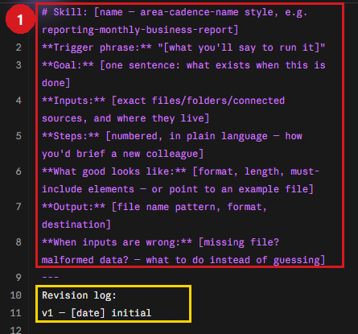
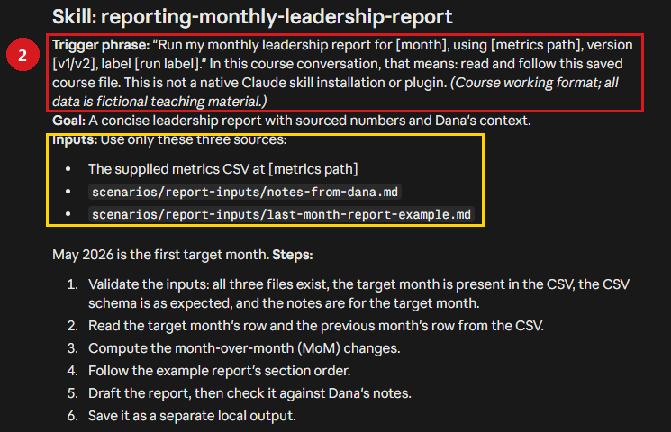
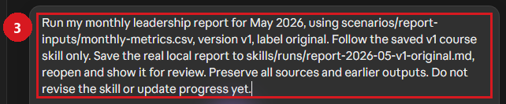
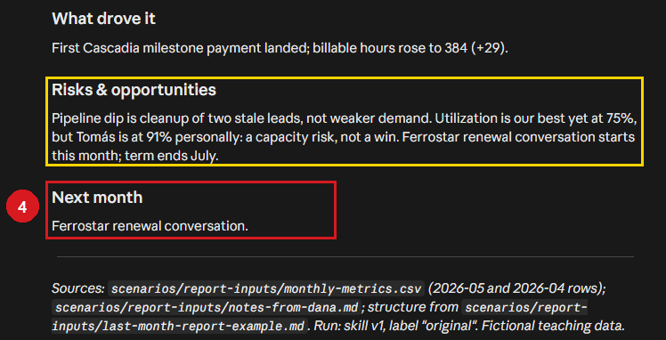
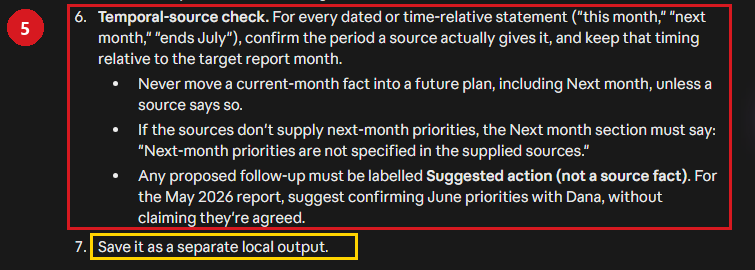
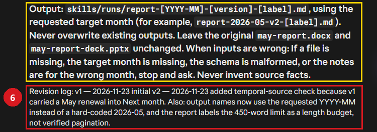
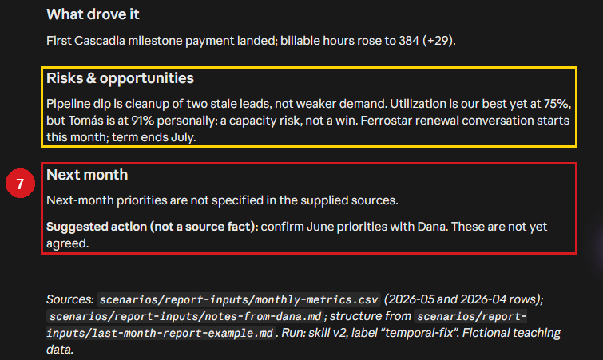
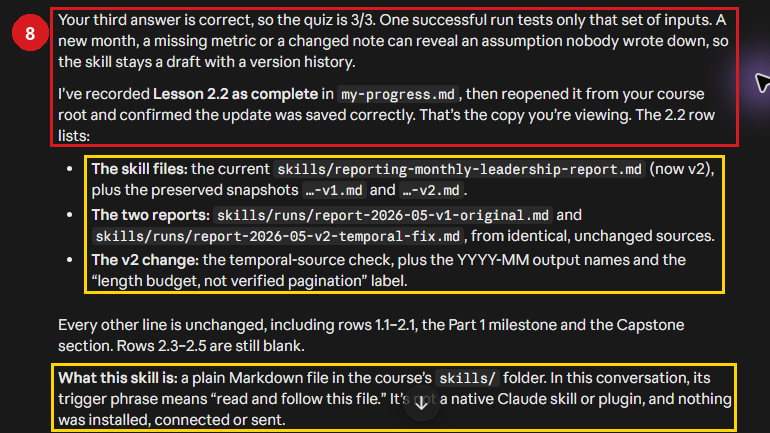

# [2.2] — Plugins and Skills
**Time:** ~25 minutes · **You'll finish with:** a working skill built from your best brief, improved through one deliberate revision cycle

## For the instructor (Claude):
- Create a `skills/` folder in the course root during this lesson (learner instructs it; explain that real Cowork skills live in the product's skills system — this folder is the course's working format and transfers directly).
- The learner turns a brief they already wrote (the 1.2 payment-status brief or 1.4 report brief) into a skill using templates/skill-template.md. Don't write it for them — draft together, learner decides each field.
- The first run must surface at least one imperfection. If the output is somehow perfect, introduce the variation test (run it against different inputs) until something breaks — the maintenance loop IS the lesson.
- "Done" looks like: `skills/[their-skill-name].md` exists, has been run twice, and version 2's instructions differ from version 1's in at least one deliberate way, noted at the bottom of the file.
- Quiz, update progress, offer 2.3.

## Concept
By now you've written briefs good enough that retyping them weekly would be absurd. A **skill** is a saved brief with the judgment written in: goal, steps, what good output looks like, where things go — written the way you'd brief a new colleague, in plain language. Trigger it with a phrase; skip the retyping forever.

What earns skill-ification? Recurrence and stability. A task you run weekly with the same *shape* (inputs change, structure doesn't) is a skill. A one-off is just a brief. The monthly report from 1.4 is a perfect skill; "figure out this weird invoice situation" from 1.2 is not — unless invoice situations turn out to be weekly, in which case congratulations, that's a skill too.

The part nobody tells you: **skills are drafts forever**. The first run always reveals an assumption you didn't write down — the report skill that never says what to do when a metric is missing, the digest skill that doesn't cap section length. The improvement loop is the actual discipline: run it, find the gap between what you got and what you meant, fix *the instructions* (not the output — fixing the output helps once, fixing the skill helps every week after), and run it again. A skill that's been through three of these cycles is worth ten that haven't been run at all.

**Plugins**, briefly: prebuilt capabilities you add rather than write — think of them as skills someone else maintains. The build-vs-add question is the same as anywhere: add for generic needs, build for anything with your team's judgment in it.

## Exercise
1. **Choose:** which brief from Part 1 would you actually rerun — the payment-status one, the monthly report, or the research decomposition? Pick one.
2. **Draft it as a skill:** create `skills/` in the course root, copy `templates/skill-template.md` into it, and fill it in together with me — you decide every field, especially "what good looks like."
3. **Run it:** trigger the skill against the same scenario files. Then hunt the gap: name one thing the output did that you didn't intend, or one decision it made that your instructions never covered. (There is one. There always is.)
4. **Fix the skill, not the output:** revise the instruction that caused it. Log the change at the bottom of the skill file: "v2 — added X because first run did Y."
5. **Run it again** and confirm the fix held.

<!-- lesson-2-2-visual-walkthrough:start -->
## Visual walkthrough: build, run, review, revise, rerun

Follow a real Claude Desktop exercise with synthetic course data. Alex turns the Lesson 1.4 monthly-report brief into a Markdown skill, decides all template fields, runs v1, identifies an actual timing gap, revises the instructions and runs v2 on the same sources. This is the course working format and a trigger in this conversation, not proof of installing a native Claude skill or a plugin. No installation, live account change or external grant is demonstrated. Outputs are Markdown; the word limit is a length budget, not verified pagination. Native PNGs are privacy-cropped without resampling and annotated with red primary/yellow supporting highlights. Open an image at full size for small text.

### 1. Start from the course template

Inspect the actual skill template, then choose all eight fields as the learner: name, trigger, goal, inputs, steps, quality, output and wrong-input handling. Plugins add prebuilt capabilities; a saved skill records the judgment in a recurring brief. This exercise creates a course Markdown file and a trigger in this conversation; it does not install a native Claude skill or plugin.



### 2. Save the learner’s v1 decisions

Alex chooses the recurring monthly leadership report from Lesson 1.4 and decides every template field with Claude. Save the current skill and an immutable v1 snapshot under skills/. Use only the original metrics, Dana notes and April example; save new Markdown reports under skills/runs/ so the earlier Word report and deck remain intact. The 450-word rule is a length budget, not verified page layout.



### 3. Trigger v1 on genuine synthetic inputs

In this conversation, the trigger means read and follow the saved instructions. Run May 2026 against the original CSV, notes and example, with version v1 and a new run label. Claude saves skills/runs/report-2026-05-v1-original.md and reopens the real local file. Preserve both the v1 instructions and its first output before reviewing the result.

```text
Run my monthly leadership report for May 2026, using scenarios/report-inputs/monthly-metrics.csv, version v1, label original.
```



### 4. Find the actual timing gap in v1

The real first output says Ferrostar’s renewal conversation starts this month under Risks, then lists it unqualified under Next month. Dana’s May notes establish current-month timing; they do not establish a June plan. This is the observed gap, rather than an invented failure. The v1 report stays unchanged as evidence.



### 5. Fix the instructions before rerunning

Add a temporal-source check: keep time-relative facts in the period supported by the source. When next-month priorities are absent, state that they are not specified. Any proposed follow-up must be labelled Suggested action (not a source fact). Revise the skill, rather than patching the old report.



### 6. Keep version history and explain the change

Retain separate v1 and v2 skill snapshots. The dated v2 log explains that v1 carried a May renewal into Next month. Two supporting improvements use the requested YYYY-MM in output names and label the word limit as a budget, not proof of pagination. These changes remain instructions for the next run, not edits to v1’s report.



### 7. Rerun on the same inputs and verify the fix

Trigger v2 for May 2026 on exactly the same three source files, saving skills/runs/report-2026-05-v2-temporal-fix.md. The actual result keeps Ferrostar in May, says next-month priorities are unspecified and labels confirming June priorities with Dana as a suggestion, not an agreed fact. Both metric tables match; revenue +5.7%, utilization +3 points, new leads −4 and pipeline about −10% trace to the CSV. A focused fix does not make the skill finished forever.

```text
Run my monthly leadership report for May 2026, using scenarios/report-inputs/monthly-metrics.csv, version v2, label temporal-fix.
```



### 8. Finish the quiz and record only this lesson

Answer the three questions individually: recurrence and stable shape, fixing the instructions rather than one output, and why even a successful skill remains a draft. Alex earns 3/3. Only Lesson 2.2 progress changes, naming the current skill, version snapshots, separate reports and the temporal-source correction. Earlier progress and the Part 1 milestone stay unchanged; 2.3–2.5 remain blank. This is a course-format Markdown skill and conversation trigger, with no native skill/plugin installation.



<!-- lesson-2-2-visual-walkthrough:end -->

## Check yourself
1. What two properties make a task worth turning into a skill?
2. Why fix the skill's instructions instead of just correcting the output?
3. Your skill ran perfectly today. Why is it still a draft?

## Going further
→ Overview, plugin picks for business teams, and scheduled tasks: claudecoworktraining.com/course/2-2-plugins-and-skills/
