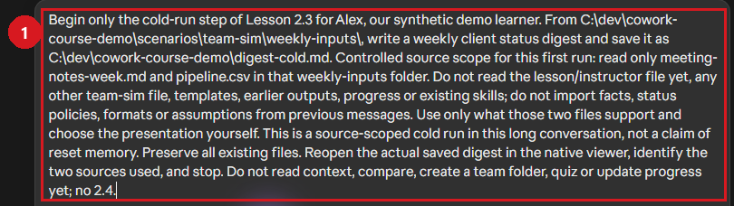
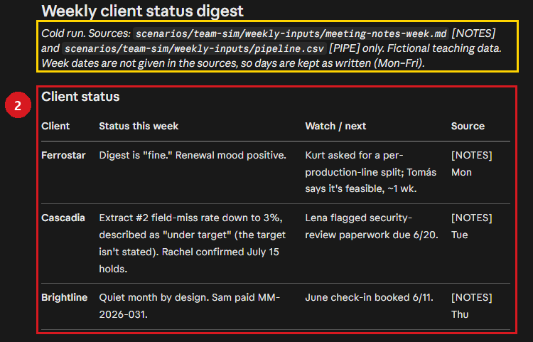
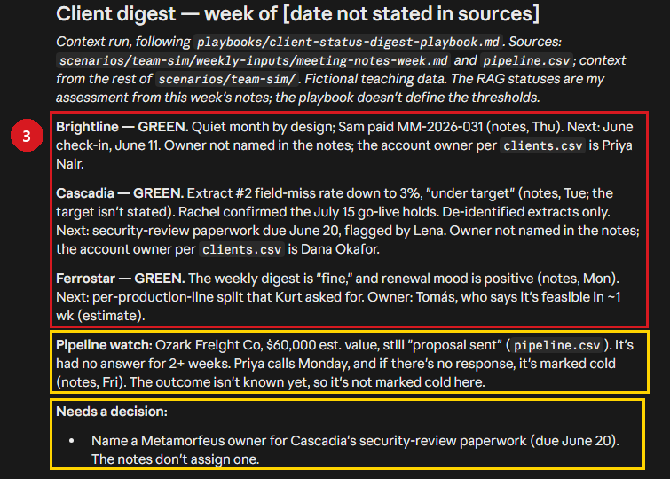
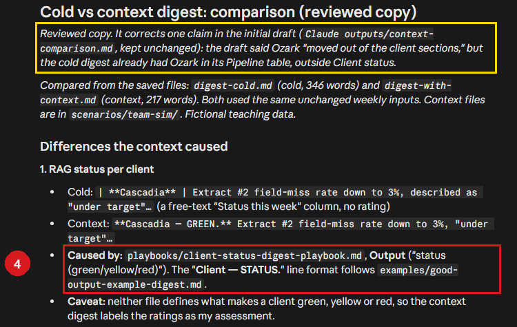
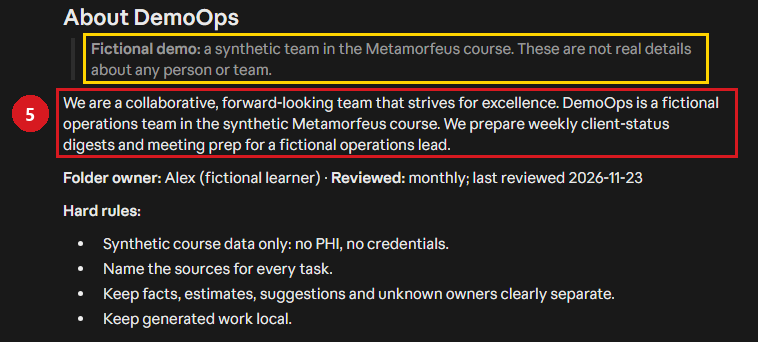
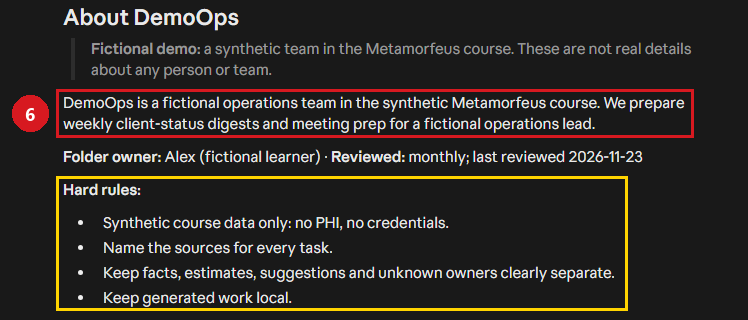
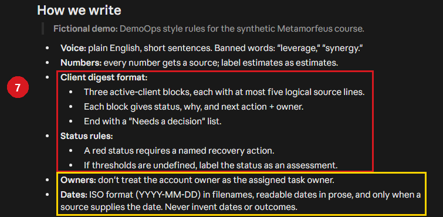

# [2.3] — Team Context Folder
**Time:** ~25 minutes · **You'll finish with:** the cold-vs-context experiment run and your own team's context folder started from the blank kit

## For the instructor (Claude):
- The proof IS the lesson: the same brief run cold vs. run with /scenarios/team-sim/ attached. Run cold first. Don't soften the cold output — its genericness is the point.
- Walk the team-sim folder as the worked example (about → style → glossary → playbooks → examples), then have the learner start THEIR OWN folder from templates/team-context-folder/ — real team, real terms. This is the first lesson where they build for their actual job.
- Their context file will be too long or too vague on draft one. Apply the test: every line should change an output. Cut lines that wouldn't.
- "Done" looks like: `digest-cold.md` and `digest-with-context.md` exist and differ visibly, and `my-team-context/` exists with at least about + style + glossary drafted.
- Quiz, update progress, offer 2.4.

## Concept
Five people using Cowork alone produce five styles of output, five sets of habits, and five different answers to "what does a status report look like here." The fix costs one folder.

A **team context folder** is a shared location holding what your team knows that Claude doesn't: who you are and what you make (*about*), how you write (*style guide*), what your words mean (*glossary* — every team has a private language; "the board numbers" means something specific at Metamorfeus and nothing anywhere else), how recurring work runs (*playbooks*), and what good looks like (*examples* — lesson 1.4 proved one example beats paragraphs of instructions; this folder is where those examples live permanently).

Attach the folder to a task and the output arrives already sounding like your team — right terms, right format, right standards — instead of arriving generic and needing the same corrections everyone always makes. The experiment in this lesson makes the difference visible in one comparison.

Two design rules keep the folder useful. **Every line must earn its place** by changing an output: "we value excellence" changes nothing, delete it; "red status requires a named recovery action" changes every digest, keep it. And **the folder needs an owner** — shared folders without owners rot, and a context folder describing last year's clients is worse than none, because it's confidently wrong. Ownership, naming, and maintenance get their full treatment in 2.4; today you build.

## Exercise (uses /scenarios/team-sim/ and /templates/team-context-folder/)
1. **Cold run:** *"From scenarios/team-sim/weekly-inputs/, write a weekly client status digest. Save as digest-cold.md."* Read it. It's competent — and it belongs to no team in particular.
2. **Context run:** *"Same task, but first read everything in scenarios/team-sim/ and follow it. Save as digest-with-context.md."* Compare: statuses in green/yellow/red, five-line cap, the 'needs a decision' ending, Ozark handled per Friday's note. Name three specific differences the folder caused, and find which context file caused each.
3. **Build yours:** copy `templates/team-context-folder/` to `my-team-context/` in the course root and draft the three core files for your real team — about, style, glossary. I'll interview you for the glossary: what would a new hire not understand in your team's Slack on day one?
4. **Apply the earn-its-place test:** we go through your about file line by line — for each, name an output it would change. Cut the rest.

<!-- lesson-2-3-visual-walkthrough:start -->
## Visual walkthrough: cold run, context run, source trace, demo kit, line review

Follow a real Claude Desktop exercise with synthetic course data: a scoped cold digest uses only the two weekly-input files, then materially the same task uses the actual team-sim context. This is an existing long conversation, not a reset-memory or controlled scientific experiment. Compare real outputs against their sources, then start a fictional demo team folder from the actual kit and apply the earn-its-place edit to a genuine saved draft. The learner substitutes their own real details privately; these pages disclose no real team information. Native PNGs are privacy-cropped without resampling, with red primary/yellow supporting highlights and full-size links for small text.

### 1. Scope the cold run before reading context

Use only the two files in weekly-inputs for the first digest and preserve its result. Exclude earlier outputs, context policies and prior conversation assumptions from the source scope. This is a scoped cold run in the existing long conversation, not proof of erased memory or a controlled scientific experiment.

```text
From scenarios/team-sim/weekly-inputs/, write a weekly client status digest. Read only meeting-notes-week.md and pipeline.csv. Save as digest-cold.md; do not use other context or earlier outputs.
```



### 2. Preserve the actual cold digest

The actual first result uses client and pipeline tables without the team playbook's colored status format or decision ending. It already retains Ozark's Friday Monday-call/conditional-cold fact, so that fact cannot later be attributed only to context. The source note and unknown date are explicit. Preserve the whole file byte-for-byte before the next run.



### 3. Inspect the real context-assisted result

The same task now follows the actual team-sim folder: three active-client blocks, green/yellow/red vocabulary, next actions and a Needs a decision ending. Here each client has two nonblank Markdown source lines; visual wrapping varies by viewport. The actual colors are labelled assessments because thresholds are not defined. Ozark remains a conditional pipeline watch, with no invented Monday outcome. The Friday fact already appeared cold. Account owner is distinguished from an unassigned paperwork owner.



### 4. Trace real differences to their context sources

Compare the saved files, rather than predicting what should differ. Four observed changes trace to the playbook’s status format and decision ending, clients.csv account owners, and the about/glossary de-identified-extract rule. The comparison initially misdescribed Ozark as moving out of client sections; review caught that cold already kept Ozark in pipeline. A corrected separate comparison preserves the original draft and states the actual change: a four-lead table becomes a targeted pipeline watch. Colors remain assessments; account owner is not task assignment.



### 5. Draft the actual kit for a fictional demo team

Walk about, style, glossary, playbooks and examples. Copy the real blank kit into my-team-context/, then decide team facts and terms as synthetic Alex. About, style and glossary explicitly describe fictional DemoOps, not Peter’s real team. The initial about draft includes the learner-supplied mission sentence alongside concrete work/audience, owner, review cadence and hard rules. Save context-about-before.md before editing. Actual learners can substitute their real details privately.



### 6. Make every instruction earn its place

For each substantive sentence, name an output it would change. The learner’s aspirational mission supplies no rule for fact selection, format or review, so remove that one sentence. The saved after file retains the concrete audience, owner/review metadata and hard rules. A separate review records before/after quotes and output tests; an exact comparison confirms every other substantive instruction is unchanged. Maintenance metadata supports clarification and source-age review, not proof of better prose by itself.



### 7. Review the usable style and glossary drafts

The saved style guide shown here gives output-shaping rules: named sources, estimate labels, the five-line cap for client blocks, status assessment caveats, red recovery actions, owner distinctions and the decision ending. The separate glossary defines six fictional team terms, including client digest, pipeline watch and cold. About/style/glossary are all drafted from the actual kit; the README/playbooks/examples skeletons remain intact. No private real-team information is used.



### Completion and image boundary

The three quiz answers were evaluated individually and the saved progress file records Lesson 2.3 complete, quiz 3/3. Only that row changed; earlier lessons, the Part 1 milestone and capstone remain unchanged, and 2.4–2.5 are blank. The final completion image is omitted because the interactive desktop disconnected and the supported capture recovery failed. Seven authentic reviewed images cover the exercise; no eighth image was invented.

<!-- lesson-2-3-visual-walkthrough:end -->

## Check yourself
1. What five kinds of files make up a context folder, and which one did lesson 1.4 already prove the power of?
2. In the experiment, pick one difference between the two digests — which context file caused it?
3. Why is an unmaintained context folder worse than no context folder?

## Going further
→ Overview and the starter kit walkthrough: claudecoworktraining.com/course/2-3-team-context-folder/
